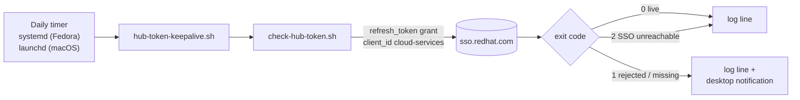

# Hub token keepalive

The Red Hat Automation Hub token in `~/.ansible.cfg` is an **offline token**,
and it expires after **30 days without use**. A Hub token that has expired
breaks certified collection installs and every Red Hat sync into Private
Automation Hub. The expiry is silent: the token still looks fine in the file.

The keepalive uses the token once a day, so it never reaches 30 days idle. It
works on Fedora and macOS, and one command installs it:

```bash
bash utilities/install-hub-token-keepalive.sh
```

It **stores no token.** It reads `~/.ansible.cfg` each time it runs, so a token
you rotate is picked up with nothing to update. It interrupts you only when
the token is actually dead.

| Script | Does |
|---|---|
| [`utilities/hub-token-keepalive.sh`](https://github.com/ericcames/sales.demos/blob/main/utilities/hub-token-keepalive.sh) | The daily job: runs the check, writes a log line, notifies on failure |
| [`utilities/install-hub-token-keepalive.sh`](https://github.com/ericcames/sales.demos/blob/main/utilities/install-hub-token-keepalive.sh) | Schedules the job — `install` (default), `--status`, `--uninstall` |
| [`utilities/check-hub-token.sh`](https://github.com/ericcames/sales.demos/blob/main/utilities/check-hub-token.sh) | The check itself, which you can also run any time by hand |

---

## How it works



`check-hub-token.sh` asks Red Hat SSO to exchange the offline token for a
short-lived access token. `ansible-galaxy` and Pulp make exactly the same
request, and it counts as a use, so it resets the 30-day clock. The access
token is thrown away. The output never includes the offline token, only its
length.

The job reacts to the three exit codes differently, on purpose:

- **Live (exit 0):** writes a log line and nothing else.
- **Rejected (exit 1):** sends a desktop notification. A dead token can only
  be replaced through a browser login, so the goal is to find out the same
  day.
- **Unreachable (exit 2):** writes a log line only. A laptop being offline is
  normal, and a daily run gets about 30 more chances before the token lapses.

### Why not cron

**Cron skips any run that falls while the laptop is asleep.** A systemd timer
with `Persistent=true` runs the missed job at the next boot or wake, and
launchd runs a missed calendar slot when the Mac wakes.

The keepalive this replaced was a crontab line, and it never worked, for two
reasons that are each easy to repeat
([ericcames/sales.demos#915](https://github.com/ericcames/sales.demos/issues/915)):

- **The line was written in `/etc/crontab` syntax**, with a user column.
  Personal crontabs have no user column, so every week cron ran a command named
  after the user and failed with no visible error.
- **The script held its own hardcoded copy of a token**, and that copy had
  drifted from `~/.ansible.cfg`. Even a working run would have kept the wrong
  token alive.

---

## Prerequisites

- **The sales.demos main checkout, not a worktree.** The timer stores the
  absolute path of the checkout it was installed from. Worktrees are deleted
  after merge, so the installer refuses to run from one.
- **A live token in `~/.ansible.cfg`**, in both `[galaxy_server.rh_certified]`
  and `[galaxy_server.rh_validated]`. See
  [First-time setup step 1](first-time-setup.md#step-1-automation-hub-token).
- **`python3`.** It's already present on Fedora. On macOS, run
  `xcode-select --install` if `python3 --version` fails.

Run every command below from the root of the sales.demos checkout.

---

## Install

=== "Fedora"

    ```bash
    cd ~/git-repos/sales.demos && git pull
    bash utilities/install-hub-token-keepalive.sh
    ```

    The installer checks the token once, writes a systemd user service and
    timer, and enables the timer. The last thing it prints is the
    `list-timers` row showing the next run.

=== "macOS"

    ```bash
    cd ~/git-repos/sales.demos && git pull
    bash utilities/install-hub-token-keepalive.sh
    ```

    The installer checks the token once, writes a LaunchAgent plist, validates
    it with `plutil`, and loads it with `launchctl bootstrap`.

    Keep the checkout **out of** `~/Documents`, `~/Desktop` and `~/Downloads`.
    macOS privacy controls stop launchd jobs from reading those folders (see
    [Troubleshooting](#troubleshooting)).

Running it again is safe: it rewrites the schedule and reloads it.

---

## Verify

Make the scheduler run the job right now, the same way it will run every day,
and read the result:

=== "Fedora"

    ```bash
    systemctl --user start sales-demos-hub-token-keepalive.service
    journalctl --user -u sales-demos-hub-token-keepalive --no-pager -n 3 -o cat
    systemctl --user list-timers sales-demos-hub-token-keepalive.timer
    ```

    The journal should end with `✅ offline token in [galaxy_server.rh_certified]
    and [galaxy_server.rh_validated] is live`, and the timer row should show a
    `NEXT` time within the next day.

=== "macOS"

    ```bash
    launchctl kickstart -k gui/$(id -u)/com.github.ericcames.sales-demos.hub-token-keepalive
    tail -n 3 ~/ansible-logs/hub-token-keepalive.log
    cat ~/ansible-logs/hub-token-keepalive.launchd.log
    ```

    A new line should appear in `hub-token-keepalive.log` within a few seconds,
    starting with today's timestamp and `rc=0 ✅`.

On both systems, every run appends one line per result to
`~/ansible-logs/hub-token-keepalive.log`:

```text
2026-10-13T07:47:00-0700 rc=0 ✅ offline token in [galaxy_server.rh_certified] and [galaxy_server.rh_validated] is live (769 chars, Red Hat SSO HTTP 200)
```

---

## Test the failure notification

Point the job at a fake config so Red Hat SSO rejects the token. Your real
`~/.ansible.cfg` isn't touched.

```bash
python3 -c "t='x'*200; print(f'[galaxy_server.rh_certified]\ntoken={t}\n[galaxy_server.rh_validated]\ntoken={t}')" \
  > /tmp/bogus-hub.cfg
HUB_TOKEN_CFG=/tmp/bogus-hub.cfg bash utilities/hub-token-keepalive.sh; echo "rc=$?"
rm /tmp/bogus-hub.cfg
```

Expect `invalid_grant — Invalid refresh token`, `rc=1`, and a notification
titled **Automation Hub token is dead**:

=== "Fedora"

    The notification is a critical `notify-send` alert from **sales.demos**,
    and it stays on screen until you dismiss it.

=== "macOS"

    The notification comes from **Script Editor**, because `osascript` sends it
    on the script's behalf. It plays the *Basso* sound. If nothing appears,
    see [Troubleshooting](#troubleshooting).

---

## Status and uninstall

```bash
bash utilities/install-hub-token-keepalive.sh --status
bash utilities/install-hub-token-keepalive.sh --uninstall
```

`--status` shows the schedule, the path of the script the job runs, and the
last five log lines. `--uninstall` stops the job and deletes the unit files or
the plist. The log stays.

---

## What gets installed

| | Fedora | macOS |
|---|---|---|
| Scheduler | systemd **user** timer — no root | launchd **LaunchAgent** — no root |
| Files | `~/.config/systemd/user/sales-demos-hub-token-keepalive.{service,timer}` | `~/Library/LaunchAgents/com.github.ericcames.sales-demos.hub-token-keepalive.plist` |
| Schedule | `OnCalendar=daily`, `RandomizedDelaySec=1h` | Daily at 10:00 |
| Missed run (asleep) | Runs at next wake/boot (`Persistent=true`) | Runs at next wake |
| Missed run (powered off) | Runs at next boot | Skipped — the next day's run covers it |
| Log | `~/ansible-logs/hub-token-keepalive.log` and `journalctl --user` | `~/ansible-logs/hub-token-keepalive.log` and `hub-token-keepalive.launchd.log` |
| Notification | `notify-send -u critical` | `osascript display notification` |

---

## Troubleshooting

| Symptom | Cause | Fix |
|---|---|---|
| Notification **Automation Hub token is dead** | Red Hat SSO rejected the token. It expired, or it was revoked | Load a new one at <https://console.redhat.com/ansible/automation-hub/token>, replace it in **both** `[rh_certified]` and `[rh_validated]`, then run `bash utilities/check-hub-token.sh` |
| `rc=2 ❌ could not reach Red Hat SSO` in the log | Offline, VPN, or a proxy | Nothing to do if it's occasional. If every line says `rc=2`, the token isn't being used: run the check by hand from a working network |
| macOS: `rc=1` in the log but no pop-up | **Script Editor** isn't allowed to send notifications | System Settings → Notifications → Script Editor → Allow notifications |
| macOS: `Operation not permitted` in `hub-token-keepalive.launchd.log` | The checkout is in `~/Documents`, `~/Desktop` or `~/Downloads`, which macOS privacy controls block for launchd jobs | Move the checkout (for example to `~/git-repos/`), then reinstall |
| Fedora: `rc=1` in the log but no pop-up | `notify-send` isn't installed, or no graphical session was running | `sudo dnf install libnotify`. The log line is written either way |
| Installer: `is a git worktree` | Run from a worktree | `cd` to the main checkout and run it there |
| Every run fails with `No such file or directory` | The job was installed from a checkout that has since moved or been deleted | Run `--status` to see the stored path, then reinstall from the main checkout |
| Installer warns `crontab still has keepalive line(s)` | An older cron-based keepalive exists | If it's superseded, delete that line with `crontab -e`. The installer never edits your crontab |

!!! warning "macOS is not yet verified on a real Mac"
    The Fedora path is verified end to end: install, a scheduled run, all three
    exit codes, the notification from inside a systemd service, status and
    uninstall. The macOS path is written for the Mac's bash 3.2 and passes lint,
    but nobody has run it on a Mac yet. If you run *Install*, *Verify* and
    *Test the failure notification* on a Mac, add a comment to
    [ericcames/sales.demos#915](https://github.com/ericcames/sales.demos/issues/915)
    and this note comes out.
